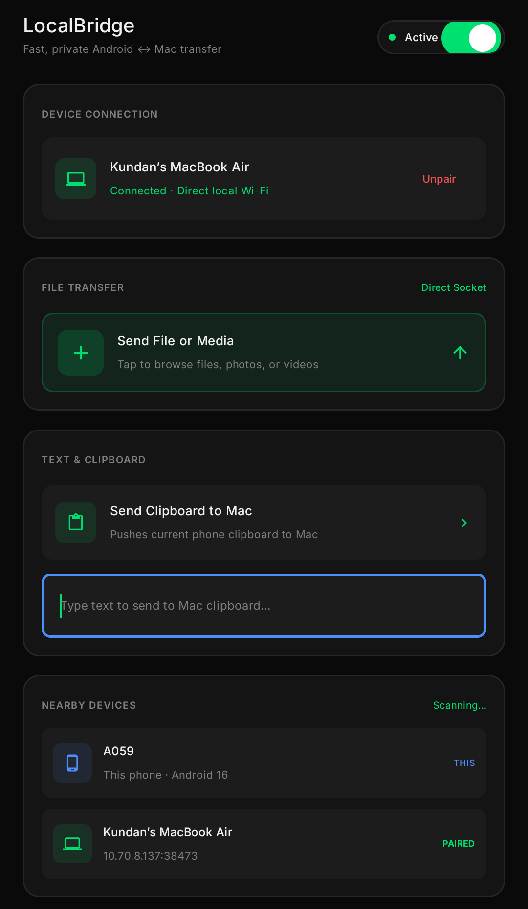
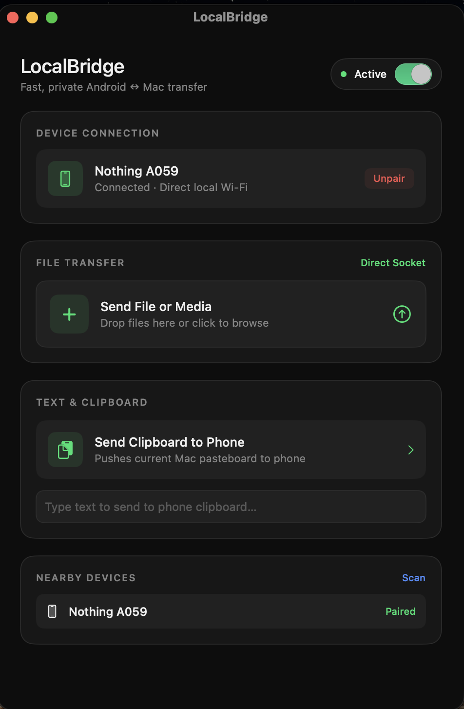
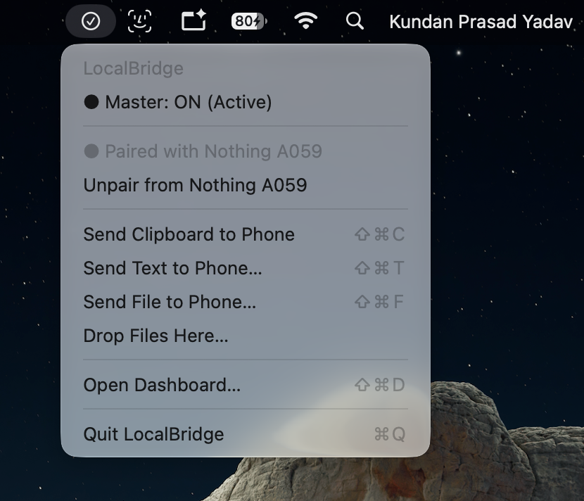

<div align="center">

# LocalBridge

### Android ↔ macOS, connected more simply.

Transfer files and share text across your devices on a local network.

[](https://github.com/ydvkundan2005/LocalBridge/releases)
[](#supported-platforms)

[Website](https://ydvkundan2005.github.io/LocalBridge/) · [Downloads](https://github.com/ydvkundan2005/LocalBridge/releases) · [Report an issue](https://github.com/ydvkundan2005/LocalBridge/issues)

</div>

---

## What is LocalBridge?

LocalBridge is a cross-platform application for moving files and text between an Android phone and a Mac. It includes device discovery, pairing, file-transfer controls, clipboard actions, and quick access from the macOS menu bar.

LocalBridge is designed for a local-network workflow; it does not require a cloud storage account for that workflow. A local connection alone does **not** guarantee that traffic is encrypted or authenticated. Review the security notes before transferring sensitive information.

## Screenshots

### Android app

<p align="center">
  
</p>

The Android dashboard shows the connection state, file-transfer entry point, clipboard actions, and nearby devices.

### macOS dashboard

<p align="center">
  
</p>

The Mac dashboard lets you see the paired device, send files, use clipboard actions, and scan for nearby devices.

### macOS menu bar

<p align="center">
  
</p>

The menu-bar menu provides quick actions without keeping the main dashboard open.

## Features

- **File transfer** between supported Android and macOS devices.
- **Clipboard and text sharing** through the supported app actions.
- **Device discovery and pairing** on a local network.
- **macOS menu-bar actions** for sending clipboard text, text, and files to the phone.
- **Drag-and-drop support** in the macOS interface.
- **Android quick access options** documented by the project, including Quick Settings, notification, and home-screen options where supported by the installed build.
- **Cross-platform implementation:** Kotlin on Android and Swift on macOS.

Feature availability may differ between builds. Clipboard behavior is affected by Android version, system restrictions, permissions, and the selected capture method. Some optional clipboard-monitoring behavior may require additional setup.

## Supported platforms

| Platform | Requirement |
|---|---|
| Android | Android 10 or later |
| macOS | macOS 13 or later |

Android application ID: `dev.localbridge.android`.

## Download and installation

Download the builds from the [GitHub Releases page](https://github.com/ydvkundan2005/LocalBridge/releases). The v6.0 release includes an Android **debug APK** and a macOS DMG. Review the notes for the specific release you choose.

### Install on Android

1. Open the [Releases page](https://github.com/ydvkundan2005/LocalBridge/releases) on your Mac or phone and choose the release you want.
2. Download the Android APK to your phone. For v6.0, the file is named `LocalBridge-android-v6.0-debug.apk`.
3. Open the downloaded APK from your Downloads folder or the file manager.
4. If Android asks to allow installation from that source, review the request. Enable it only if you trust the APK and its source.
5. Complete the installation and open LocalBridge.
6. Grant only the permissions needed for the features you use.

**Note:** The v6.0 APK is a debug build, not a production Play Store release. Android may show warnings for apps installed from outside Google Play.

### Install on macOS

1. Open the [Releases page](https://github.com/ydvkundan2005/LocalBridge/releases) and download the DMG. The v6.0 file is named `LocalBridge-v6.0.dmg`.
2. Open the downloaded DMG.
3. Follow the installation steps supplied with that release. If the DMG contains an app to move, follow the instructions displayed in the mounted disk image.
4. Eject the mounted disk image when finished.
5. Open LocalBridge from the installed location.

macOS may show security warnings depending on the build's signing and notarization status. Do not bypass a warning unless you have independently verified the build and trust its source.

## How to use LocalBridge

### 1. Prepare both devices

1. Install and open LocalBridge on Android and macOS.
2. Connect both devices to the same **trusted local Wi-Fi network**. Network isolation, VPN settings, or firewall rules may prevent discovery even when the devices appear to be on the same Wi-Fi.
3. On Android, make sure the app's top **Active** switch is on if you want the phone to be available for connection.
4. Keep both apps open during first-time setup so you can see discovery and pairing status.

### 2. Discover and pair the devices

1. Open the LocalBridge dashboard on your Mac.
2. Use **Scan** in the **Nearby Devices** section if the phone is not listed.
3. On Android, review the **Nearby Devices** section. Wait for the Mac to appear; its name may be the Mac's computer name.
4. Select the relevant nearby device and follow the pairing instructions shown by the installed build. Do not pair with a device you do not recognize.
5. When pairing is complete, check that the Android **Device Connection** section shows the Mac as connected and that the Mac menu shows the paired phone.

The exact pairing prompt can vary by build. If a device does not appear, see [Troubleshooting](#troubleshooting).

### 3. Send a file from Android to Mac

1. Open LocalBridge on Android.
2. In **File Transfer**, tap **Send File or Media**.
3. Choose the file, photo, or video you want to send using the Android file picker.
4. Follow any transfer prompts shown by the app and check the Mac for the received file or transfer status.

Send a small test file first when confirming a new connection.

### 4. Send a file from Mac to Android

1. Open the LocalBridge menu from the macOS menu bar, or open the Mac dashboard.
2. Choose **Send File to Phone…** from the menu, or use the dashboard's file-transfer area if available in your installed build.
3. Select the file, or use **Drop Files Here…** / drag and drop when supported by the current Mac build.
4. Follow the transfer status shown by the app and check the Android device for the received file.

The menu-bar screenshot shows **Shift + Command + F** as the shortcut for **Send File to Phone…**.

### 5. Send clipboard text from Android to Mac

1. Copy the text on your Android phone.
2. Open LocalBridge on Android.
3. Tap **Send Clipboard to Mac**.
4. Check the Mac's clipboard by pasting into a text field or document.

Android limits some background clipboard access. If automatic or background clipboard behavior is not available, open the app and use the visible clipboard action.

### 6. Send typed text from Android to Mac

1. Open the Android LocalBridge dashboard.
2. In **Text & Clipboard**, tap the text field labeled **Type text to send to Mac clipboard…**.
3. Enter the text you want to send.
4. Use the send action provided by your installed build, if shown, and check the Mac clipboard by pasting into a text field.

If the installed build does not show a send control or the text is not transferred, use **Send Clipboard to Mac** after copying the text and consult the current build's status notes.

### 7. Send clipboard or text from Mac to Android

From the macOS menu-bar menu:

- Choose **Send Clipboard to Phone** to send the current Mac clipboard.
- Choose **Send Text to Phone…** to enter text to send.

The menu-bar screenshot displays these shortcuts:

| Action | Shortcut shown in the menu |
|---|---|
| Send Clipboard to Phone | `⇧⌘C` (Shift + Command + C) |
| Send Text to Phone… | `⇧⌘T` (Shift + Command + T) |
| Send File to Phone… | `⇧⌘F` (Shift + Command + F) |
| Open Dashboard… | `⇧⌘D` (Shift + Command + D) |
| Quit LocalBridge | `⌘Q` (Command + Q) |

Shortcuts can vary between releases. Use the shortcuts displayed in your installed app if they differ from this list.

### 8. Use the macOS menu bar

The menu-bar menu can show whether LocalBridge is active and which phone is paired. From the menu, the shown actions include:

- Check the current **Master: ON (Active)** state.
- Review the paired-device name.
- Choose **Unpair from …** to unpair the connected phone when needed.
- Send clipboard text, typed text, or a file to the phone.
- Choose **Drop Files Here…** when available.
- Open the full dashboard or quit LocalBridge.

Keep LocalBridge running when you need menu-bar actions. Quitting the app stops its app-level functionality until it is opened again.

### 9. Disconnect or unpair a device

Use **Unpair** in the connection section or **Unpair from …** in the Mac menu when you want to remove the current pairing. Pair again from the device-discovery screen when you want to reconnect. Only unpair a device you intend to disconnect.

## Build from source

### Android requirements

- Android Studio or a compatible Android development environment
- JDK 21
- Required Android SDK components
- The Gradle wrapper included in the repository

The Android project is configured with minimum SDK 29, target SDK 36, and compile SDK 37. From the repository root, run:

```bash
cd android
./gradlew assembleDebug
```

The debug APK is normally generated at:

```text
android/app/build/outputs/apk/debug/app-debug.apk
```

### macOS requirements

- macOS 13 or later
- A Swift toolchain compatible with Swift 6.2
- Xcode Command Line Tools or an appropriate Swift development environment

From the repository root, run:

```bash
cd mac
swift build -c release
```

The executable is normally generated at:

```text
mac/.build/release/LocalBridgeMac
```

These commands build the app components. Producing a distributable DMG may require additional packaging steps.

## Troubleshooting

### The phone and Mac do not find each other

- Confirm both devices are connected to the same trusted Wi-Fi network.
- Check whether a VPN, guest Wi-Fi, client isolation, firewall, or network permission is blocking local discovery.
- Make sure LocalBridge is active on Android and the Mac app is running.
- Use **Scan** on the Mac dashboard and allow a little time for discovery.
- Restart the apps and retry pairing.

### Pairing or connection fails

- Make sure you selected the correct device name.
- Unpair stale pairings if necessary, then try pairing again from the nearby-device list.
- Keep both apps open during setup and follow any pairing prompt shown by the installed build.

### A file does not transfer

- Confirm the devices are connected or paired.
- Try a small test file and verify that the destination has enough storage.
- Review Android file/media permissions and any status or error message shown by the app.
- Check whether the Mac firewall or local network is blocking communication.

### Clipboard sharing does not work

- Try the explicit **Send Clipboard to Mac** or **Send Clipboard to Phone** action.
- Confirm that the clipboard contains the text you intend to send.
- Remember that Android restricts some clipboard operations in the background; foreground use may be required.
- Check the current release notes for setup requirements of optional clipboard-monitoring features.

### macOS blocks the app

- Verify that the installer came from the official [GitHub Releases page](https://github.com/ydvkundan2005/LocalBridge/releases).
- Review the macOS warning and the build's signing/notarization status before deciding whether to proceed.
- Do not disable security protections broadly just to run the app.

If the problem continues, [open an issue](https://github.com/ydvkundan2005/LocalBridge/issues) with your OS versions, app version, steps to reproduce, and relevant non-sensitive logs. Do not post passwords, private files, signing keys, or other secrets.

## Network and security notes

LocalBridge is intended for local-network communication. A local connection does **not** by itself guarantee confidentiality, authentication, or protection from interception by other devices on the network.

- Use trusted networks, especially for sensitive files.
- The current Android network security configuration permits cleartext traffic.
- The configuration trusts system and user-installed certificates.
- Do not assume all transfers are encrypted or protected from interception.
- Review the network security configuration and connection implementation before using the app for confidential data.
- Install only builds from sources you trust, and review Android permissions carefully.

## Repository structure

```text
LocalBridge/
├── android/             # Android application and Gradle configuration
├── mac/                 # macOS app and Swift package
├── shared/              # Shared protocol test fixtures
├── docs/
│   └── images/          # README screenshots
├── test-evidence/       # Development test evidence
├── index.html           # Project website
├── styles.css           # Website styling
├── script.js            # Website JavaScript
├── STATUS.md            # Development status and release notes
└── README.md
```

The project includes Kotlin Android code, Swift macOS code, SwiftNIO networking components on macOS, WebSocket-based communication, Bonjour-based discovery, and shared protocol test fixtures.

## Current release and license

- **Documented version:** 6.0
- **Android application ID:** `dev.localbridge.android`
- **Downloads:** [GitHub Releases](https://github.com/ydvkundan2005/LocalBridge/releases)
- **Website:** [LocalBridge](https://ydvkundan2005.github.io/LocalBridge/)

See [`STATUS.md`](STATUS.md) and the release notes for build-specific details. A license has not yet been selected for this repository, so do not assume the code may be copied, modified, or redistributed under an open-source license.

## Contributing

Bug reports, documentation improvements, and suggestions are welcome. Before submitting a change, check for an existing issue, describe the proposed change clearly, and include reproduction steps for bug reports. Do not commit credentials, signing keys, local SDK paths, crash dumps, or generated build artifacts.

Open an [issue](https://github.com/ydvkundan2005/LocalBridge/issues) or submit a pull request in the repository.

---

<div align="center">

**LocalBridge**
*Your Android and Mac, connected more simply.*

[Website](https://ydvkundan2005.github.io/LocalBridge/) · [Repository](https://github.com/ydvkundan2005/LocalBridge) · [Releases](https://github.com/ydvkundan2005/LocalBridge/releases)

</div>
